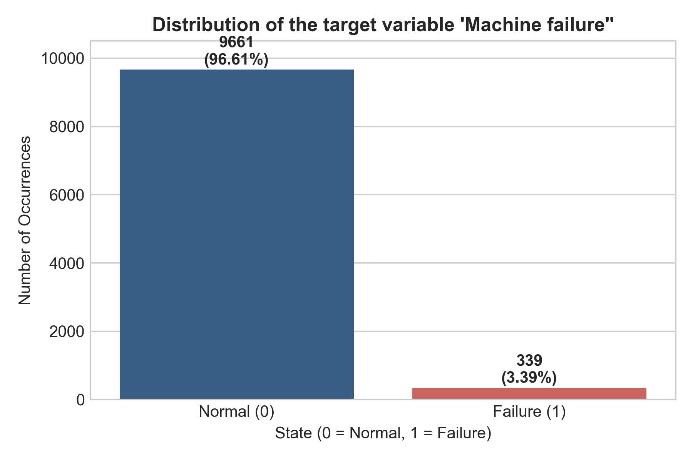
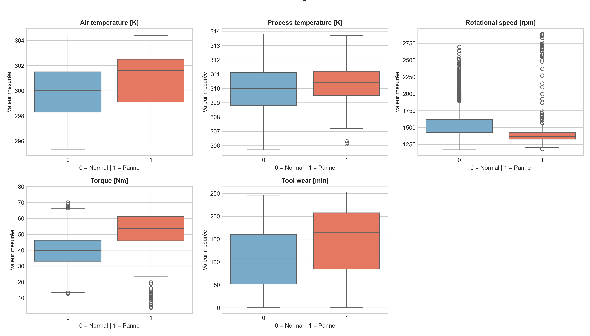
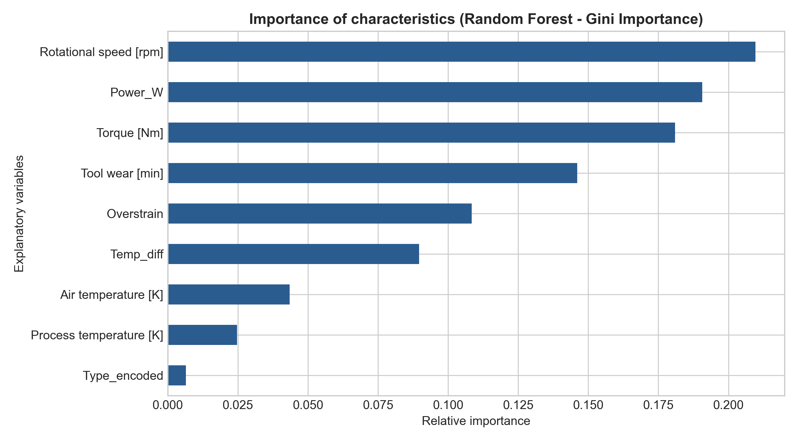

# 🛠️ Industrial Predictive Maintenance — AI4I 2020 Dataset

Project for the early detection of failures on a digital machining unit (CNC milling machine) based on signals from physical sensors (10,000 operations).

---

## 📌 Context and Business Challenge

In automated machining workshops, an undetected failure leads to an abrupt halt in the production line, the breakage of cutting tools, and high maintenance costs. This project frames predictive maintenance as a **supervised binary classification** problem:

* **Class 0 (Healthy):** Machine operating as intended (**96.61%**).
* **Class 1 (Failure):** Breakdown or imminent anomaly (**3.39%**).

Given this severe class imbalance, **Accuracy** (96.61% for a naive model) is ineffective. The optimization prioritizes **Recall** to minimize false negatives (unanticipated critical failures), while maintaining sufficient **Precision** to prevent teams from being overwhelmed by false alarms.

  

---

## ⚙️ Data Leakage Prevention & Feature Engineering

### 1. Anti-Data Leakage Protocol
* **Removal of identifiers:** `UDI` and `Product ID` (non-predictive database keys).
* **Exclusion of failure modes:** `TWF`, `HDF`, `PWF`, `OSF`, and `RNF`. These post-incident diagnostic columns are deterministic with respect to the target; retaining them would result in a trivial information leak.

### 2. Engineered Physical Variables
To overcome the limitations of linear separations, three combined variables were incorporated:
* **Thermal gradient ($\Delta T$):** $T_{\text{process}} - T_{\text{air}}$ in Kelvin (for monitoring heat dissipation).
* **Useful mechanical power ($P$):** $\text{Torque} \times (\text{Speed} \times \frac{2\pi}{60})$ in Watts (for monitoring motor overloads and load losses).
* **Cumulative wear stress (*Overstrain*):** $\text{Torque} \times \text{Tool wear}$ in $\text{Nm}\cdot\text{min}$ (for monitoring insert failure due to fatigue).

  

---

* **Logistic Regression:** Excellent recall (88.24%, with only 8 missed failures), but it generates 277 false alerts—a number that is unmanageable in an industrial setting.
* **Random Forest:** Virtually eliminates false alerts (only 2 false alarms out of 1,932 healthy machines), with a high F1-score of 0.8333.
* **Operational Recommendation:** Lower the classification probability threshold from 0.50 to 0.35 to capture more failures without compromising precision.
  

  

---

## 📁 Directory Organization

predictive-maintenance-ml/
├── Data/
│   └── ai4i2020.csv                 
├── notebooks/
│   └── maintenance_ai4i.ipynb         
├── reports/
│   ├── figure/                        
│   └── rapport_maintenancefinal.docx  
├── TASK 1.pdf                          
└─  README.md                           
                
